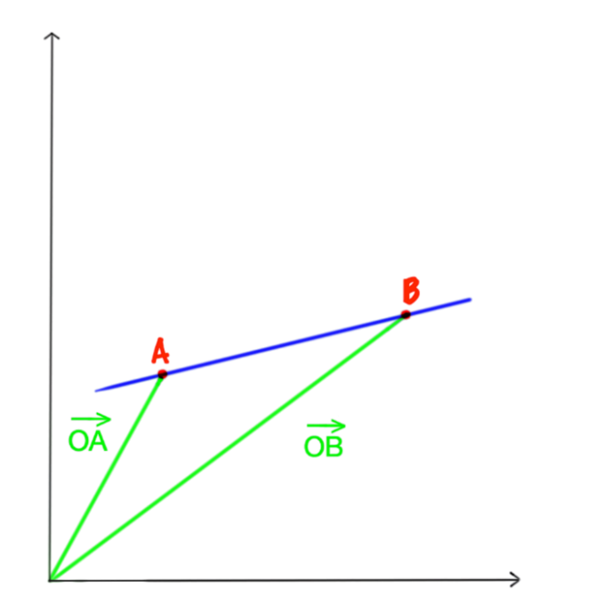

## Finding the Equation of a Line

  - To find the equation of the line, given 2 points A and B:
    
      - Find the direction vector using

$$
AB = OB - OA
$$

  - Substitute the values into the equation:
    
    **r = a** $+ \ t$**b**
    
    where a = point A
    
    b = direction vector (vector AB)
    
    t = some scalar
