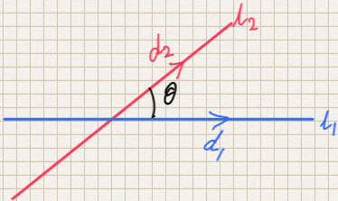

## Angle between Two Lines

  - Use dot product rule on the two direction vectors:

$$
\frac{\text{a.b}}{\left| a \right|\left| b \right|} = \cos\theta
$$

  - Note: $a$ and $b$ must be moving away from the point at which
    they intersect

