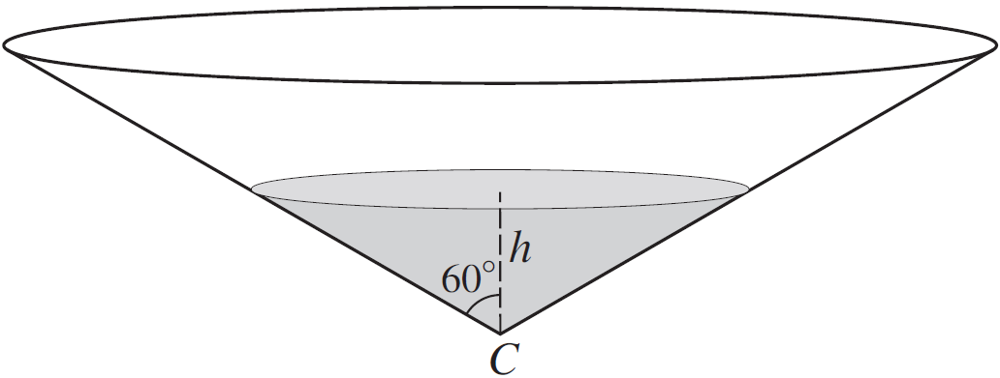

# Differential Equations

- Form a differential equation using the information given
  - If something is proportional, add constant of proportionality $k$
  - If rate is decreasing, add a negative sign
- Separate variables, bring $\text{dx}$ and $\text{dt}$ on
    opposite sides
  - Integrate both sides to form an equation
  - Add arbitrary constant
  - Use conditions given to find $c$ and/or $k$

&nbsp;

**{W10-P33} Question 9:**

A biologist is investigating the spread of a weed in a particular
region. At time$\ t$ weeks, the area covered by the weed
is$\ Am^{2}$. The biologist claims that rate of increase of$\ A$ is
proportional to$\ \sqrt{2\text{A } - \ 5}.$

1.  Write down a differential equation given info

2.  At start of investigation, area covered by weed was$\ 7m^{2}$.
    $10$ weeks later, area covered$\  = 27m^{2}$ Find the area
    covered$\ 20$ weeks after the start of the investigation.

**
Solution:
**

**Part (i)**

$$
\frac{\text{dA}}{\text{dt}} \propto \sqrt{2A - 5} = k\sqrt{2A - 5}
$$

**Part (ii)**

*Proceed to form an equation in*$\text{ A}$ *and*$\text{ t}$*:*

$$
\frac{\text{dA}}{\text{dt}} = k\sqrt{2A - 5}
$$

*Separate variables*

$$
\frac{1}{\sqrt{2A - 5}}dA = kdt
$$

*Integrate both sides*

$$
kt + c = \left( 2A - 5 \right)^{\frac{1}{2}}
$$

*When*$\ t = 0$*:*

$A = 7\  \therefore\  c = 3\ $

$$
kt + 3 = \left( 2A - 5 \right)^{\frac{1}{2}}
$$

*When*$\ t = 10$*:*

$$
10k + 3 = \left( 2\left( 27 \right) - 5 \right)^{\frac{1}{2}}
$$

$$
10k = \sqrt{49} - 3
$$

$$
k = 0.4
$$

*Now substitute* $20$ *as*$\text{ t}$ *and then
find*$\text{ A}$*:*

$$
0.4\left( 20 \right) + 3 = \left( 2A - 5 \right)^{\frac{1}{2}}
$$

$$
11 = \left( 2A - 5 \right)^{\frac{1}{2}}
$$

$$
121 = 2A - 5
$$

$$
A = 63m^{2}
$$

&nbsp;

**{S13-P31} Question 10:**

Liquid is flowing into a small tank which has a leak. Initially the tank
is empty and,$\ t$ minutes later, the volume of liquid in the tank
is$\ \text{V }cm^{3}$. The liquid is flowing into the tank at a
constant rate of $80\ cm^{3}$ per minute. Because of the leak, liquid
is being lost from the tank at a rate which, at any instant, is equal to
$\text{kV }cm^{3}$ per minute where $\text{k }$is a positive
constant.

i.  Write down a differential equation describing this situation and
    solve it to show that:

$$V = \frac{1}{k}\left( 80 - 80e^{- kt} \right)$$

$$k = \frac{4 - 4e^{- 15k}}{25}$$

ii.  Work out the volume of liquid at $t = 20$ and state what happens to
    volume after a long time.

**
Solution:
**

**Part (i)**

*Represent the given information as a derivative:*

$$
\frac{\text{dV}}{\text{dt}} = 80 - kV
$$

*Proceed to solve the differential equation:*

$$
\frac{\text{dt}}{\text{dV}} = \frac{1}{80 - kV}
$$

$$
dt = \frac{1}{80 - kV}\text{dV}
$$

$$
\int_{}^{}{\left( 1 \right)\text{dt}} = \int_{}^{}\frac{1}{80 - kV}\text{dV}
$$

$$
t + c = - \frac{1}{k}\ln\left| 80 - kV \right|
$$

*Use the given information; when*$\ t = 0,\ V = 0$*:*

$$
\therefore c = - \frac{1}{k}\ln\left( 80 \right)
$$

*Substitute back into equation:*

$$
t - \frac{1}{k}\ln\left( 80 \right) = - \frac{1}{k}\ln\left| 80 - kV \right|
$$

$$
t = \frac{1}{k}\ln\left( 80 \right) - \frac{1}{k}\ln\left| 80 - kV \right|
$$

$$
t = \frac{1}{k}\ln\left( \frac{80}{80 - kV} \right)
$$

$$
kt = \ln\left( \frac{80}{80 - kV} \right)
$$

$$
e^{\text{kt}} = \frac{80}{80 - kV}
$$

$$
80 - kV = \frac{80}{e^{\text{kt}}}
$$

$$
kV = 80 - 80e^{- kt}
$$

$$
V = \frac{1}{k}\left( 80 - 80e^{- kt} \right)
$$

**Part (ii)**

*After carrying out the iterations, the following result will be
obtained:*

$$k = 0.14\ \left( 2d.p. \right)$$

**Part (iii)**

*Simply substitute into the equation’s*$\text{ t}$*:*

$$
V = \frac{1}{0.14}\left( 80 - 80e^{- 0.14\left( 20 \right)} \right) = 537\ cm^{3}
$$

*The volume of liquid in the tank after a long time **approaches** the
max volume:*

$$
V = \frac{1}{0.14}\left( 80 \right) = 571\ cm^{3}
$$

**{W13-P31} Question 10:**

‎

A tank containing water is in the form of a cone with
vertex$\text{ C}$. The axis is vertical and the semi-vertical angle
is$\ 60{^\circ}$, as shown in the diagram. At time$\ t = 0$, the
tank is full and the depth of water is$\ H$. At this instant, a tap
at$\ C$ is opened and water begins to flow out. The volume of water in
the tank decreases at a rate proportional to$\ \sqrt{h}$,
where$\text{ h}$ is the depth of water at time *t*. The tank becomes
empty when$\ t = 60$.

$$
\frac{\text{dh}}{\text{dt}} = - Ah^{- \frac{3}{2}}
$$

i.  Solve differential equation given in part i and obtain an expression
    for$\text{ t}$ in terms of$\text{ h }$and$\text{ H}$.

**
Solution:
**

**Part (i)**

*First represent info they give us as an equation:*

$$
V = \frac{1}{3}\pi r^{2}h
$$

$$
r = \tan 60 \times h = h\sqrt{3}
$$

$$
\therefore V = \frac{1}{3}\pi\left( h\sqrt{3} \right)^{2}h = \pi h^{3}
$$

$$
\frac{\text{dV}}{\text{dh}} = 3\pi h^{2}
$$

$$
\frac{\text{dV}}{\text{dt}} \propto - \sqrt{h} = - kh^{\frac{1}{2}}
$$

*Find the rate of change of*$\text{ h}$*:*

$$
\frac{\text{dh}}{\text{dt}} = \frac{\text{dV}}{\text{dt}} \div \frac{\text{dV}}{\text{dh}}
$$

$$
\frac{\text{dh}}{\text{dt}} = \frac{- kh^{\frac{1}{2}}}{3\pi h^{2}} = - \frac{k}{3\pi}h^{- \frac{3}{2}}
$$

**Part (ii)**

$$
dt = \frac{1}{- Ah^{- \frac{3}{2}}}\text{dh}
$$

$$
\int_{}^{}\text{Adt} = \int_{}^{}\frac{1}{- h^{- \frac{3}{2}}}\text{dh}
$$

$$
At + c = - \frac{2}{5}h^{\frac{5}{2}}
$$

*Use given information to find unknowns; when*$\ t = 0$*:*

$$
- A\left( 0 \right) + c = \frac{2}{5}\left( H \right)^{\frac{5}{2}}\ \ \ \ \therefore c = \frac{2}{5}H^{\frac{5}{2}}
$$

*When*$\ t = 60:$

$$
- A\left( 60 \right) + c = 0
$$

$$
c = 60A
$$

$$
A = \frac{1}{150}H^{\frac{5}{2}}
$$

*Thus the initial equation becomes:*

$$
- \frac{1}{150}H^{\frac{5}{2}}t + \frac{2}{5}H^{\frac{5}{2}} = \frac{2}{5}h^{\frac{5}{2}}
$$

$$
H^{\frac{5}{2}}\left( - \frac{t}{150} + \frac{2}{5} \right) = \frac{2}{5}h^{\frac{5}{2}}
$$

$$
- \frac{t}{150} + \frac{2}{5} = \frac{2h^{\frac{5}{2}}}{5H^{\frac{5}{2}}}
$$

$$
\frac{t}{150} = \frac{2}{5} - \frac{2h^{\frac{5}{2}}}{5H^{\frac{5}{2}}}
$$

$$
t = 150\left( \frac{2}{5} - \frac{2h^{\frac{5}{2}}}{5H^{\frac{5}{2}}} \right) = 60 - 60h^{\frac{5}{2}}H^{- \frac{5}{2}}
$$

$$
t = 60\left( 1 - \left( \frac{h}{H} \right)^{\frac{5}{2}} \right)
$$