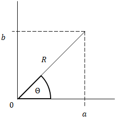
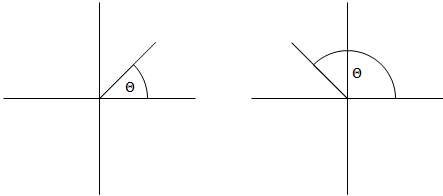
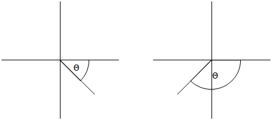

## Argand Diagram

*For the complex number* $z = a + bi$

$$
\left| z \right| = \sqrt{a^{2} + b^{2}}
$$

$$
\arg z = \tan^{- 1}\frac{b}{a}
$$

- Simply plot imaginary ($y$-axis) against real ($x$-axis):

‎

**Argument:**

Always: $- \pi < \theta < \pi$

‎

‎

- The position of $z^{*}$ is a reflection in the $x$-axis of $z$
