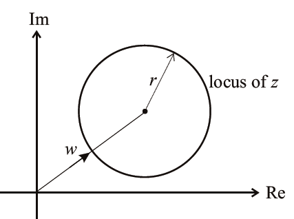
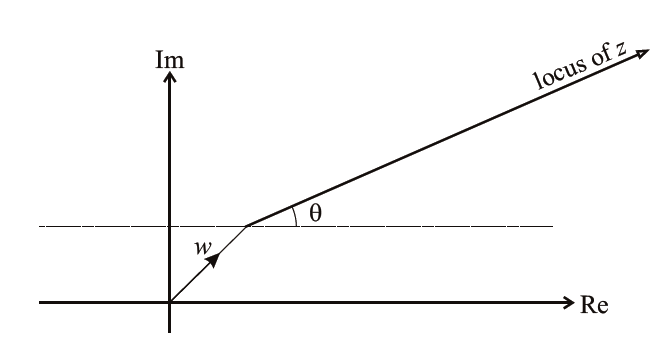
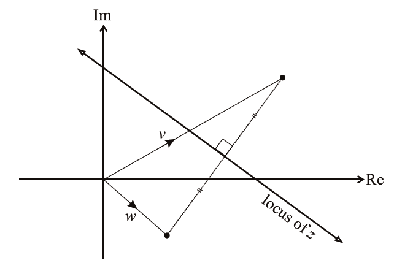
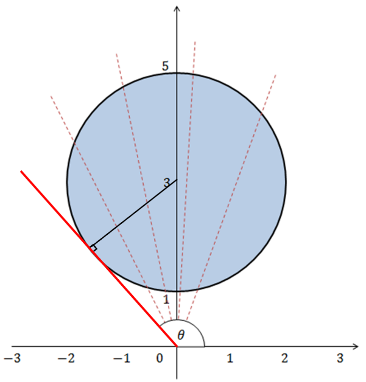
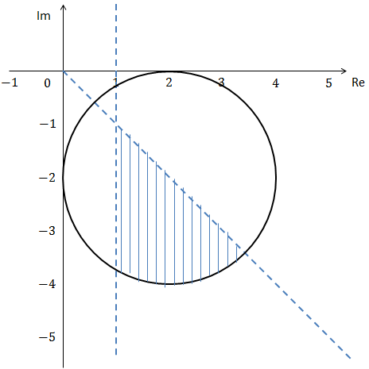
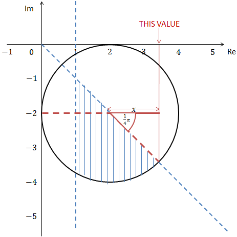

## Locus

$$
\left| \mathbf{z - w} \right|\mathbf{= r}
$$

The locus of a point $z$ such that $\left| z - w \right| = r$, is a
circle with its centre at $w$ and with radius $r$.

$$
\mathbf{\arg}\mathbf{(z - w)}\mathbf{= \theta}
$$

The locus of a point$\text{ z}$ such that $\arg{(z - w)} = \theta$
is a ray from$\text{ w}$, making an angle $\theta$ with the
positive real axis.

$$
\left| z - w \right| = \left| z - v \right|
$$

The locus of a point $z$ such that
$\left| z - w \right| = \left| z - v \right|$ is the perpendicular
bisector of the line joining $w$ and $v$

&nbsp;

**{W11-P31} Question 10:**

On a sketch of an Argand diagram, shade the region whose points
represent the complex numbers $\text{z }$which satisfy the
inequality$\left| z - 3i \right| \leq 2$. Find the greatest value of
$\arg\text{z }$for points in this region.

**
Solution:
**

*The part shaded in blue is the answer.*

*To find the greatest value of* $\arg z$ *within this region we must
use the tangent at point on the circle which has the greatest value of*
$\theta$ *from the horizontal (red line)*

*The triangle magnified*

‎

$$
\sin{\alpha = \frac{2}{3}}
$$

$$
\alpha = 0.730
$$

$$
\theta = \alpha + \frac{\pi}{2} = 0.730 + \frac{\pi}{2} = 2.30
$$

&nbsp;

**{W11-P31} Question 10:**

i.  On a sketch of an Argand diagram, shade the region whose points
    represent complex numbers satisfying the inequalities  
    $\left| z - 2 + 2i \right| \leq 2,\ \arg z \leq - \frac{1}{4}\text{π }$and$\ Re\ z \geq 1$,

ii.  Calculate the greatest possible value of$\text{ Re z}$ for
    points lying in the shaded region.

**
Solution:
**

**Part (i)**

*Argand diagram:*

**Part (ii)**

*The greatest value for the real part of* $z$ *would be the one which
is furthest right on the* $\text{Re}$ *axis but within the limits of
the shaded area. Graphically:*

*Now using circle and Pythagoras theorems we can find the value of*
$x$*:*

$$
x = 2 \times \cos{\frac{1}{4}\pi}
$$

$$
x = \sqrt{2}
$$

$\therefore$ greatest value of $Re\ z = 2 + \sqrt{2}$
