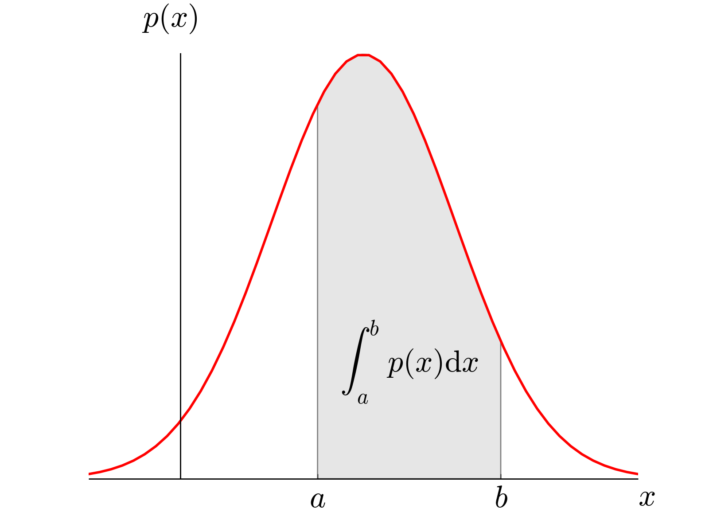

# Continuous Random Variables

## Probability Density Functions (pdf)

* Function whose area under its graph represents probability used for
  continuous random variables
* Represented by $f(x)$

 

**Conditions:**

* Total area always $= 1$

$$\int_{c}^{d}{f(x)}\ dx = 1$$

* Cannot have negative probabilities $\therefore$ graph cannot dip
  below $x$-axis; $f(x) \geq 0$
* Probability that $X$ lies between $a$ and $b$ is the area from
  $a$ to$\text{\ b}$

$$P\left( a < X < b \right) = \int_{a}^{b}{f\left( x \right)}\text{\ dx}$$

* Outside given interval $f\left( x \right) = 0$; show on a sketch
* $P(X = b)$ always equals $0$ as there is no area
* Notes:
  * $P\left( X < b \right) = P(X \leq b)$ as no extra area added
  * The mode of a pdf is its maximum (stationary point)

**{IS Ex 9a} Question 6:**

Given that:

$$
f(x) = \begin{cases} kx(6 - x) & 2 < x < 5 \\ 0 & \text{otherwise} \end{cases}
$$

1. Find the value of $k$
2. Find the mode, $m$
3. Find $P(X < m)$

**Solution:**

**Part (i):**

*Total area must equal 1 hence*

$$\int_{2}^{5}{\text{kx}\left( 6 - x \right)} = \left\lbrack 3kx^{2} - \frac{kx^{3}}{3} \right\rbrack_{2}^{5} = 1$$

$$= 75k - \frac{125}{3}k - 12k + \frac{8}{3}k = 24k = 1$$

$$\therefore k = \frac{1}{24}$$

**Part (ii):**

*Mode is the value which has the greatest probability hence we are
looking for the max point on the pdf*

$$\frac{d}{\text{dx}}\left\lbrack \text{kx}\left( 6 - x \right) \right\rbrack = 6k - 2kx$$

*Finding max point hence stationary point*

$$6k - 2kx = 0$$

$$x = \frac{6\left( \frac{1}{24} \right)}{2\left( \frac{1}{24} \right)} = 3$$

$\therefore$ mode $= 3$

**Part (iii):**

$P(X < m)$ *can be interpreted as* $P( - \infty < X < m)$

$$\int_{- \infty}^{m}{\text{kx}\left( 6 - x \right)} = \int_{2}^{3}{\text{kx}\left( 6 - x \right)} = \left\lbrack 3kx^{2} - \frac{kx^{3}}{3} \right\rbrack_{2}^{3}$$

$$= \frac{1}{24}\left( {3(3}^{2}) - \frac{3^{3}}{3} - 3(2^{2}) + \frac{2^{3}}{3} \right) = \frac{13}{36}$$