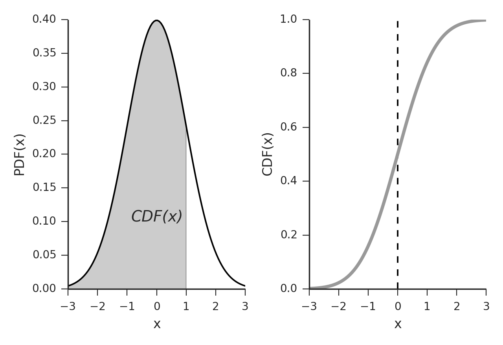

## The Median

**The Cumulative Distribution Function
(cdf)**

  - Gives the probability that the value is less than$\text{~b}$ 

$P(X < b)$ or $P(X \leq b)$

  - Represented by $F\left( b \right)$

  - It is the integral of $f\left( x \right)$

$$F\left( b \right) = \int_{- \infty}^{b}{f(x)}\text{\ dx}$$

  - Median: the value of $b$ for which $F\left( b \right) = 0.5$

