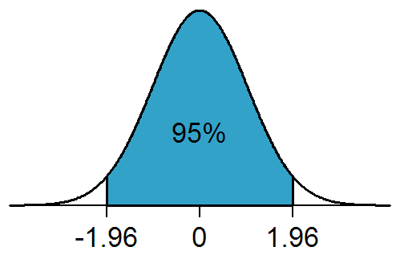

## Percentage Points for a Normal Distribution

  - The percentage points are determined by finding the $z$-value of
    specific percentages

  - E.g. to find the $z$-value of a 95% confidence level, we can see
    that the $5\%$ would be removed equally from both sides
    ($2.5\%$) so the $z$-value we would actually be finding would be
    of $100\% - 2.5\% = 97.5\%$

**Percentage Points Table**

| **Confidence level**     | 90%   | 95%   | 98%   | 99%   |
| ------------------------ | ----- | ----- | ----- | ----- |
| $\mathbf{z}$**-value** | 1.645 | 1.960 | 2.326 | 2.576 |
