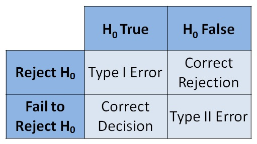

## Type I and Type II Errors 

  - A **Type I error** is made when a true null hypothesis is rejected

  - A **Type II** **error** is made when a false null hypothesis is
    accepted

  - **P(Type I error)** = significance level

  - **Calculating P(Type II error):**
    
      - Firstly, calculate the acceptance region by leaving
        $\overline{x}$ as a variable and equating the test statistic
        to the significance level
    
      - Next, calculate the conditional probability that $\mu$ is now
        $\mu'$ and$\ \overline{x}$ is still in the acceptance region

P($\overline{x}$ is in acceptance region | $\mu = \mu'$)

Calculate this by substituting the limit of the acceptance region as
$\overline{x}$ (calculated previously) and the new, given $\mu'$
into the test statistic equation and find the probability