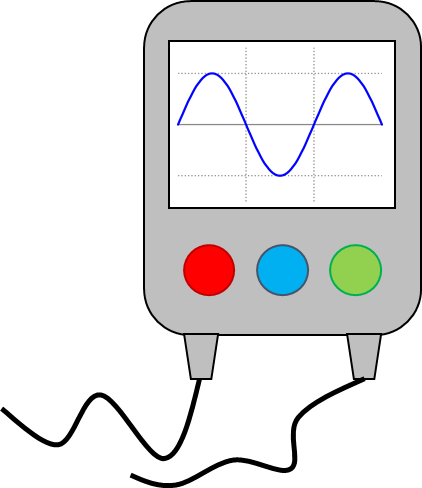

# Apparatus & Additional Details

## General Experiments

### Apparatus:

* **Signal generator:** can be used to produce a sound/voltage/current
  and can vary frequency settings on device

* **Micrometer:** can be used to measure small distances
* **Vernier calipers:** can be used to measure small distances
* **Set square:** used to make sure apparatus perpendicular
* **Magnets:** can be used with metal objects in experiment
* **Balance:** can be used to weigh a mass
* **Burette:** accurately measuring volume of liquid
* **Diffraction grating:** can be used to measure wavelength of a
  monochromatic light source

 

### Additional Details:

* **Measuring amplitude and period using a c.r.o**
  * Adjust time-base and $y$-gain to achieve a suitable waveform
  * Calculate amplitude by finding height in terms of boxes on grid
    of waveform and multiplying by $y$-gain
  * Calculate period by counting boxes of grid occupied by a full
    waveform and multiply by time-base setting

