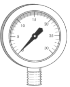

## Pressure Experiments

### Apparatus:

  - **U-Tube (manometer):** measures pressure difference between two
    fluids

  - **Bourdon gauge:** measuring pressure of a gas or liquid

  - **Pump:** can be used to alter pressure in a container
