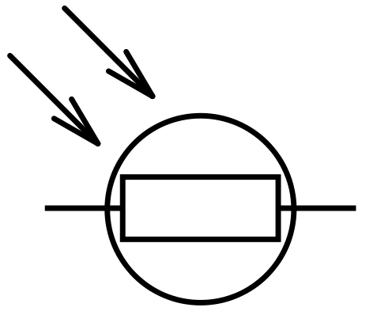
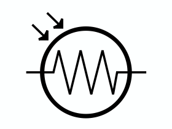

## Electrical Experiments

### Apparatus: 

  - **Variable resistor (rheostat):** can be used to alter
    voltage/current supplied in a circuit or can be used to keep current
    constant

  - **LDR:** resistance decreases with increasing light intensity

  - **Photocell:** sensors that allow you to detect light – generate an
    e.m.f when light is incident

### Additional Details:

  - Use a protective resistor to reduce current

  - Switch off currents when not in use so that wires/coil do not
    overheat

  - Use microammeter and galvanometer for small voltages and currents

  - When using ammeter and voltmeter to measure resistance, a power
    supply is required

  - **Type of current to use:**
    
      - Large current to create a large magnetic field
    
      - Large current to produce measurable e.m.f./voltage
    
      - Small current to reduce heating effect
