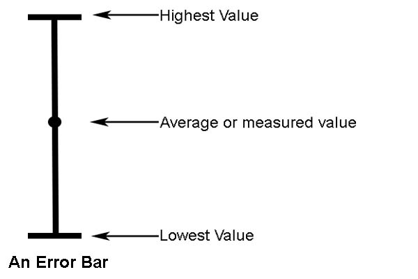

## Graphs

* Firstly, plot the best value of each variable on the graph
* Next, add and subtract the error and plot this above and below the
  best value.
* Join the three points together to form the error bar

* **Line of best fit:** should pass through most ‘best’ values and
  must be passing through each error bar
* **Worst acceptable line:** the shallowest or steepest possible line
  that passes through or close to every error bar e.g. lowest value
  and highest value (label the line)

  Join the top of the topmost point's error bar and the bottom of the
  bottommost error bar and the line should touch every error bar

 

**Determining error in gradient and** $\mathbf{y}$**-intercept:**

* After plotting both lines, calculate the gradient of each line by
  forming a triangle with a hypotenuse of length greater than half the
  graph. Leave all construction lines
* Calculate the gradient of the line of best fit and subtract from the
  worst fit to find error in gradient.
* If broken axis used, form equation of both lines and find the
  $y$-intercept
* If normal axis used, read off value from the graph
* Subtract the two $y$-intercepts to find the error

 

**Finding constants in given relationship**:

* Using values calculated i.e. gradient and $y$-intercept, equate coefficients of the equation of the line with relationship to find constants.

