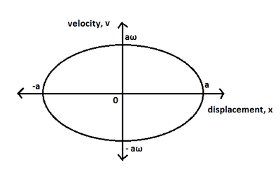
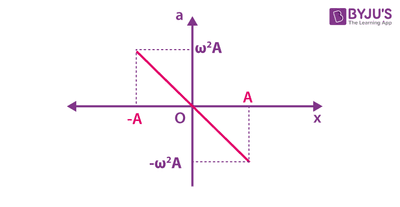

## Graphs of SHM

***Note:*** *These graphs are valid only if the motion starts from a positive extreme point ( cosine graph ). If it starts from the mean position, we use a sin graph with the same values on the axis.*

### Velocity and Displacement Graph

### Acceleration and Displacement Graph

