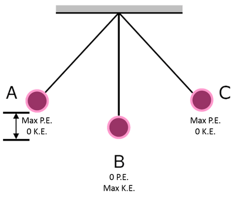
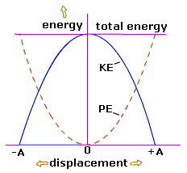
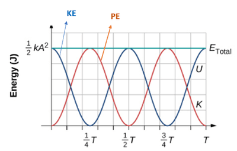

## Energy in SHM

**Kinetic Energy:**

$$
v = \pm \omega\sqrt{(x_{0}^{2} - x^{2})}
$$
$$
E_{k} = \frac{1}{2}mv^{2}
$$

$$
E_{k} = \frac{1}{2}m\omega^{2}(x_{0}^{2} - x^{2})
$$

**Total Energy:**

At $x = 0$, $E_{k}$ is max and $=$ to total energy

$$
E_{k} = \frac{1}{2}m\omega^{2}(x_{0}^{2} - {(0)}^{2})
$$

$$
\text{therefore}\ E_{\text{total}} = \frac{1}{2}m\omega^{2}x_{0}^2
$$

**Potential Energy:**

$$
E_{\text{total}} = E_{k} + E_{p} \text{ so }\ E_{p} = E_{\text{total}} - E_{k}
$$

$$
= \frac{1}{2}m\omega^{2}x_{0}^2 - \frac{1}{2}m\omega^{2}\left\( x_{0}^{2} - x^{2} \right\)
$$

$$
E_{p} = \frac{1}{2}m\omega^{2}x^2
$$

**Graphs:**

### Energy Time Graph (with the starting position being the mean position)

### Explanation:

During simple harmonic motion (SHM), total mechanical energy is continuously swapped between **kinetic energy ($E_k$)** and **potential energy ($E_p$)**:

* **At the equilibrium position (center, $x = 0$):**

  * **Speed is maximum**, so **kinetic energy ($E_k$) reaches its maximum**.

  * Displacement is zero, so **potential energy ($E_p$) is zero**.

* **At maximum displacement (extremes, $x = \pm A$):**

  * The object momentarily stops ($v = 0$), so **kinetic energy ($E_k$) is zero**.

  * **Potential energy ($E_p$) reaches its maximum**.

* **In between extreme positions and equilibrium:**

  * As the object moves toward equilibrium, $E_p$ converts into $E_k$.

  * As the object moves toward an extreme, $E_k$ converts back into $E_p$.

Assuming no damping (friction/air resistance), the total energy remains constant:

$$

E_{\text{total}} = E_k + E_p = \frac{1}{2} m \omega^2 A^2

$$