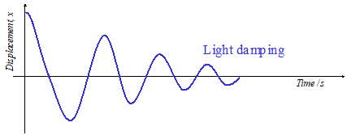
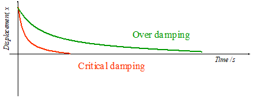

## Damping

**Damping:** loss of total energy and reduction in amplitude from an oscillating system caused by resistive forces acting in the opposite direction to the motion (e.g. friction)

**Light damping:** The system oscillates about equilibrium position with decreasing amplitude over a period of time e.g. a pendulum or an hanging mass in non ideal conditions

* **Critical damping:** the system does not oscillate & is the amount of damping required such that the system returns to its equilibrium position in the shortest possible time e.g. a closing door or car brakes
* **Heavy damping:** damping is so great that the displaced object never oscillates but returns to its equilibrium position very very slowly e.g. oscillations in viscous liquids such as honey

### How to increase Damping?

* Use more viscous liquid to carry out oscillations in e.g. Honey
* Area of the oscillatory object to be increased