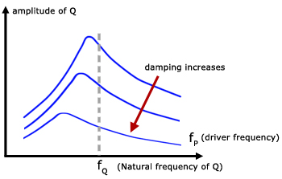

## Damping and Resonance

* Effects of damping on the frequency response of a system undergoing forced oscillations:
  * Decreases amplitude at all frequencies
  * Slightly decreases resonant frequency
  * The resonant peak becomes flatter

 