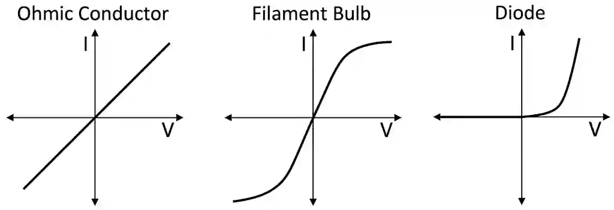

## Measuring Temperature

A thermometer uses a physical property that varies with temperature is used for the measurement of temperature, e.g:

* Change in volume of a liquid or gas
* Change in volume of gas at constant pressure
* Change in electrical resistance
* Change in e.m.f. of a thermocouple

#|
||

**Physical Property**

|

**Thermometer Type**

|

**Behavior with Temperature**

|

**Key Characteristics**

||
||

Liquid Density

|

Liquid in glass

|

Liquid expands (density drops)

|

Easy and cheap but not as accurate and sensitive as others

||
||

Gas Volume

|

Constant pressure gas thermometer

|

$V \propto T$ (Charles's Law)

|

Complex setup and must be calibrated but has high accuracy and sensitivity

||
||

Electrical Resistance

|

Thermistor/ platinum resistance

|

Thermistor: $R \downarrow$ as $T \uparrow$

Metal: $R \uparrow$ as $T \uparrow$

|

Very sensitive at narrow range of temperatures

||
||

Electromotive Force

|

Thermocouple

|

e.m.f. increases with $\Delta T$

|

Capable of mearsuring high temperatures and rapid changing temperatures as well as measuring temperatures at a far distance

||
|#

