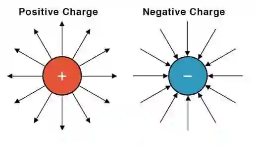

# Electric Fields

## Introduction

* **Field of Force:** A region of space where an object experiences a non-contact force (such as gravitational, electric, or magnetic).

* **Definition of Electric Field:** The force exerted per unit positive charge at a given point in space.

* The direction of field lines shows the direction of the field – always from the positive charge to the negative.

* The higher density of lines shows a stronger region of the field.

* **Charge Interactions:**

  * Like charges (e.g., positive and positive) repel each other.

  * Opposite charges (e.g., positive and negative) attract each other.

**Electric Field Strength ($E$):**

* Defined as the force per unit positive charge exerted on a stationary positive charge at a point ($E = \frac{F}{q}$).

* Vector quantity measured in $\text{N C}^{-1}$ or $\text{V m}^{-1}$.