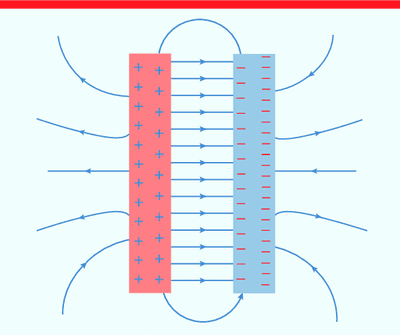

## Uniform Electric Field

* **Definition & Production:** A uniform electric field has a constant magnitude and direction at all points. It is typically created between two parallel charged plates separated by a small distance.

* **Field Strength ($E$):**

  * Calculated using $E = \frac{V}{d}$, where $V$ is potential difference and $d$ is plate separation.

  * Measured in $\text{V m}^{-1}$, which is equivalent to $\text{N C}^{-1}$.

* **Work Done ($W$):**

  * The work done moving a charge $q$ between the plates across potential difference $V$ is given by $W = Vq$.

* **Particle Motion:** Charged particles experience a constant electric force $F = qE$, causing uniform acceleration across the field (and parabolic trajectories when entering perpendicularly).