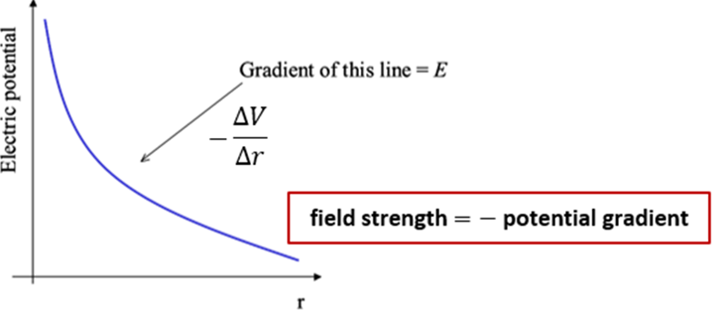

## Electric Potential

* **Definition of Electric Potential ($V$):** The work done per unit positive charge in bringing a small test charge from infinity to a specific point ($V = \frac{W}{Q}$).
* Using these equations,  $V = \frac{W}{Q}$ and $W = F \cdot d$ we can obtain:

$$
V = \frac{F \cdot d}{Q}
$$

$$
V = \frac{Q}{4\pi\varepsilon_{o}r}
$$

* This is a scalar quantity
* The **potential difference** between two points A and B from an
  isolated charge $Q$ is defined as work done in taking a unit
  positive charge from B to A

$$
V_{\text{AB}} = \frac{Q}{4\pi\varepsilon_{0}}\left\( \frac{1}{b} - \frac{1}{a} \right\)
$$

* $V_{\text{AB}}$ is equal to the gain in electrical potential
  energy if Q is positive and loss if Q is negative

**In general,**

* If -ve charge moves in the direction of the electric field, its electric potential energy will increase.
* If \+ve charge moves in the direction of an electric field, its electric potential energy will decrease.
* If a charge is accelerated in the field, its electrical potential energy will be converted to kinetic $\therefore Vq = \frac{1}{2}mv^{2}$

**Potential Gradient:**

* The electric field strength ($E$) at a point is equal to the negative of the potential gradient at that point ($E = -\frac{\Delta V}{\Delta x}$).

**Electric Potential Energy ($E_p$):**

* The potential energy stored between two point charges $Q$ and $q$ separated by distance $r$ is:

  $$E_p = \frac{Qq}{4\pi\varepsilon_0 r}$$

**Electric Potential Between Opposite Charges:**

* **Concept:** Electric potential is a scalar quantity ($V = V_1 + V_2$).

* **Opposite Charges ($+Q$ and $-Q$):**

  * At the exact midpoint between equal and opposite charges, $V_{\text{net}} = \frac{kQ}{r} + \frac{k(-Q)}{r} = 0\text{ V}$.

  * The potential drops smoothly from positive near $+Q$, passes through $0\text{ V}$ at the midpoint, and becomes negative near $-Q$.

**Neutral Points & Zero Field:**

* **Two Like Charges ($+Q$ and $+Q$):**

  * **Electric Field ($E$):** At the exact midpoint, field vectors point in opposite directions and cancel out $\implies \mathbf{E = 0}$ (**Neutral Point**).

  * **Electric Potential ($V$):** Potentials add up scalar-wise, so potential at the midpoint is **positive and non-zero** ($V = \frac{2kQ}{r}$).

* **Two Opposite Charges ($+Q$ and $-Q$):**

  * **Electric Field ($E$):** Fields from both charges point in the same direction (from $+$ to $-$), so $\mathbf{E \neq 0}$ at the midpoint (it reaches a minimum non-zero magnitude).

  * **Electric Potential ($V$):** Positive and negative potentials cancel out $\implies \mathbf{V = 0}$ at the midpoint.