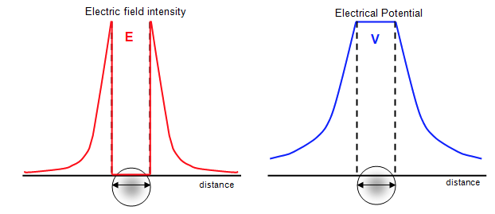

## Potential Due to a Conducting Sphere

* A charge $+ Q$ on an isolated conducting sphere is uniformly
  distributed over its surface
* The charge remains on the surface and at all points inside the sphere, the field strength is 0
* As there is no field inside the sphere, the potential difference
  from any point inside the sphere to the surface is zero. Therefore,
  the potential at any point inside a charged hollow sphere is the
  same as its surface

