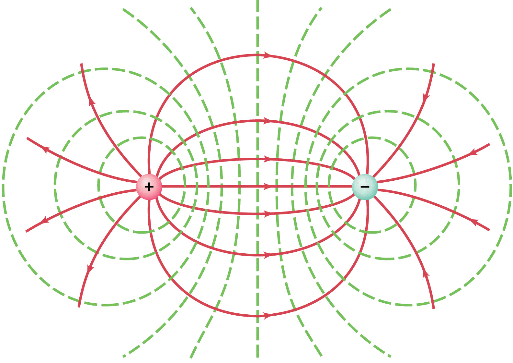

## Equipotential

* **Equipotential surface**: a surface where the electric potential is
  constant
* ***E***quipotential lines are drawn such that potential is constant
  between intervals
* As potential constant, the potential gradient = 0, hence **E along
  surface = 0**
* Hence, no work is done when a charge is moved along this surface

* Electric field lines must meet the equipotential surface at **right angles**
* Spacing will be closer when the field is stronger

