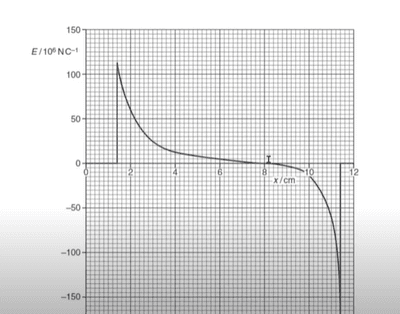
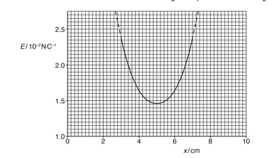
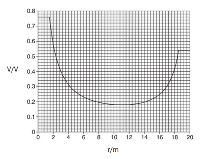

## Graphs Between Two Charged Particles

### Electric Field between like charges

### 

**Behavior:** As you move from the first charge toward the second, the field strength drops to **zero** (the neutral point) where the opposing forces cancel out.

### Electric Field between opposite charges

**Behavior:** The field points continuously in the same direction (from $+Q$ to $-Q$), so it **never reaches zero**. The field strength decreases as you move away from $+Q$, hits a **minimum positive value at the midpoint**, and then increases again as you approach $-Q$.

### Electric Potential between two positive charges

**Behavior:** Because electric potential is a scalar ($V = V_1 + V_2$), values always add up positively. The potential drops as distance from either charge increases, reaching a **non-zero minimum at the midpoint**, resulting in a $U$-shaped curve between the charges.