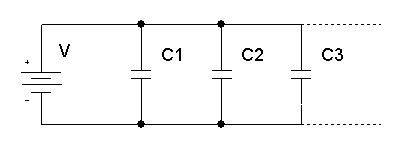

## Capacitors in Parallel

1. For parallel capacitors, since $V$ is identical across all branches, substitute $Q = CV$ (or $Q_1 = C_1 V$, $Q_2 = C_2 V$, $Q_3 = C_3 V$) into the total charge equation:

   * $Q_T = Q_1 + Q_2 + Q_3$

   * $Q_T = C_1 V + C_2 V + C_3 V$

2. Factor out $V$:

   * $Q_T = V(C_1 + C_2 + C_3)$

3. Divide both sides by $V$:

   * $\frac{Q_T}{V} = C_1 + C_2 + C_3$

4. Since total capacitance $C_T = \frac{Q_T}{V}$:

   * $C_T = C_1 + C_2 + C_3$

**Parallel Example:** Two capacitors of capacitance $4,\mu\text{F}$ and $8,\mu\text{F}$ are connected in parallel across a $12\text{ V}$ power supply. Find the total charge.

$C_T = C_1 + C_2 = 4,\mu\text{F} + 8,\mu\text{F} = 12,\mu\text{F}$

$\text{Total charge } Q_T = C_T V = 12,\mu\text{F} \times 12\text{ V} = 144,\mu\text{C}$