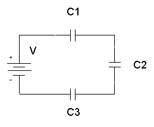

## Capacitors in Series

1. The charge ($Q$) stored on each capacitor is **identical** ($Q = Q_1 = Q_2 = Q_3$) because charge separation on one capacitor induces an equal charge on the next. The total potential difference ($V_T$) is shared across the components ($V_T = V_1 + V_2 + V_3$):

   * $V_{T} = V_{1} + V_{2} + V_{3}$

2. Apply $Q = CV$ and $Q$ same in series

   * $V_{T} = Q\left\( \frac{1}{C_{1}} + \frac{1}{C_{2}} + \frac{1}{C_{3}} \right\)$

   * $\frac{V_{T}}{Q} = \frac{1}{C_{1}} + \frac{1}{C_{2}} + \frac{1}{C_{3}}$

3. Hence,

   * $\frac{1}{C_{T}} = \frac{1}{C_{1}} + \frac{1}{C_{2}} + \frac{1}{C_{3}}$

**Series Example:** Two capacitors of capacitance $3,\mu\text{F}$ and $6,\mu\text{F}$ are connected in series across a $12\text{ V}$ power supply. Find the total charge.

$$\frac{1}{C_T} = \frac{1}{3} + \frac{1}{6} = \frac{3}{6} \implies C_T = 2,\mu\text{F}$$

$$\text{Total charge } Q = C_T V = 2,\mu\text{F} \times 12\text{ V} = 24,\mu\text{C}$$