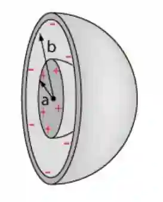

## Capacitance of a Spherical Shape Capacitor

* Any isolated body can have a capacitance.
* Considering a sphere of radius $r$ carrying charge $Q,$ the potential at the surface is

$$
V = \frac{Q}{4\pi\varepsilon_{o}r}
$$

$$
C = \frac{Q}{V} = \frac{Q}{\frac{Q}{4\pi\varepsilon_{o}r}} = 4\pi\varepsilon_{o}r
$$

