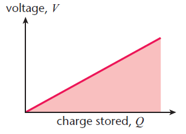

## Energy Stored in a Capacitor

- Area under a potential-charge graph is equal to work done

$$

W = \frac{1}{2}QV = \frac{1}{2}CV^{2} = \frac{1}{2}\cdot\frac{Q^2}{C}

$$

- The half comes in because:

  - When the first charge flows onto the capacitor plates there is
    no potential difference opposing the flow

  - As more charge flows, the potential difference increases, so
    more work is done

  - The average potential difference is equal to half the maximum
    potential difference