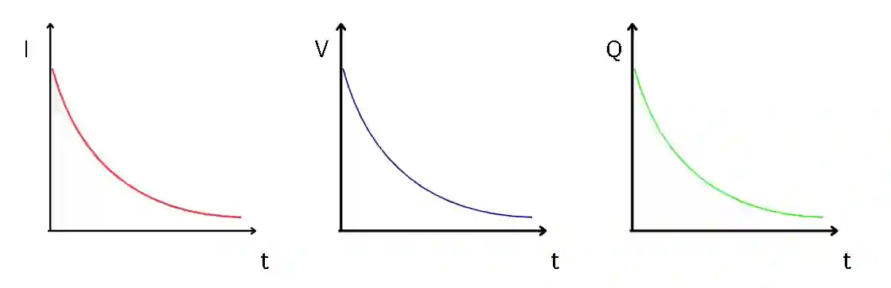

## **Discharging a Capacitor**

* Connecting a Capacitor across a resistor allows charge to flow through the resistor. The graphs for current, potential difference, and charge all show exponential decrease until the Capacitor discharges completely.

* All the equations for discharging a Capacitor through a resistor follow the form of $X(t) = X_{0}e^{-t/RC}$ where X can represent current (I), potential difference (V), or charge (Q) for time t after discharge.

  * $I(t) = I_{0}e^{-t/RC}$
  * $V(t) = V_{0}e^{-t/RC}$
  * $Q(t) = Q_{0}e^{-t/RC}$

**Discharging Capacitor Example Question:**

* **Question:** A capacitor initially charged to $12\text{ V}$ discharges through a resistor. The time constant of the circuit is $3.0\text{ s}$. Calculate the potential difference across the capacitor $6.0\text{ s}$ after discharge begins.

* **Solution:**

$$V(t) = V_0 e^{-\frac{t}{RC}}$$

$$V(6.0) = 12 \times e^{-\frac{6.0}{3.0}} = 12 \times e^{-2} \approx 12 \times 0.1353 = 1.63\text{ V}$$

**Time constant ($\tau$)**

* The time constant is the amount of time it takes the charge, current, or potential difference to fall to 37% (1/e) of its initial value.

* It is given by the equation $\tau = RC$.  A larger resistance (R) or capacitance (C) results in a larger time constant ($\tau$), which shows that the capacitor discharges more slowly.

* After 5 time constants, the potential difference fall to below 1% of the max value; we can consider a capacitor to be fully discharged after 5 time constants

**Time Constant Example Question:**

* **Question:** Ethan has a gaming laptop which has a $470,\mu\text{F}$ capacitor that is connected in series with a $10\text{ k}\Omega$ resistor. Calculate the time constant $\tau$ of the circuit, and determine how long it takes for the potential difference to drop to below 1% of its initial value.

* **Solution:**

$$\tau = R \times C = (10 \times 10^3,\Omega) \times (470 \times 10^{-6}\text{ F}) = 4.7\text{ seconds}$$

A capacitor is considered fully discharged (below 1%) after $5$ time constants:

$$t = 5\tau = 5 \times 4.7\text{ s} = 23.5\text{ seconds}$$