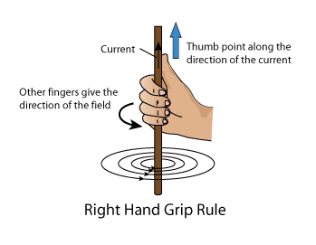
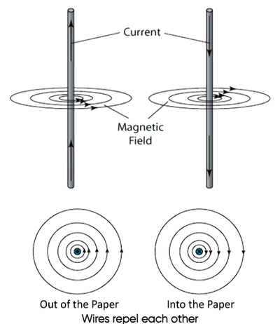
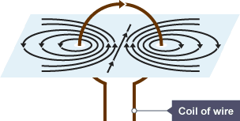
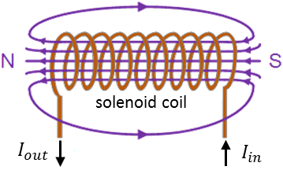

## Electromagnetism

**Strength of magnetic field can be increased by:**

- Increasing the current

- Increasing number of turns per unit length of solenoid

- Using soft-iron core within solenoid

**Right Hand Grip Rule:**

- **For a long, straight conductor:**

  - Magnetic field lines are concentric circles centered at the
    conductor

  - Separation between adjacent field lines increases with distance
    from the conductor

  - Magnetic field is non-uniform

- **For a flat, circular coil:**

  - Magnetic field pattern produced represents that produced by a
    short bar magnet

- **For a solenoid and flat, circular coil:**

  - Magnetic field pattern produced identical to that produced by a
    bar magnet

  - Magnetic field lines within solenoid are parallel indicating
    strength is same (uniform field)

**Question:**

Kouki has a solenoid of length $0.25\text{ m}$ consists of $800$ turns of wire and carries a current of $3.0\text{ A}$.

1. State two ways the magnetic field strength inside this solenoid can be increased without changing its dimensions.

2. Explain why adding a soft-iron core inside the solenoid significantly increases the magnetic flux density.

**Solution / Answer:**

1. Increase the current passing through the coil, or insert a ferrous (soft-iron) core inside the solenoid.

2. Soft iron has a much higher magnetic permeability than air, allowing it to easily concentrate magnetic field lines. Additionally, the iron core becomes magnetized by the field, contributing its own magnetic domain alignment to vastly increase the total flux density.