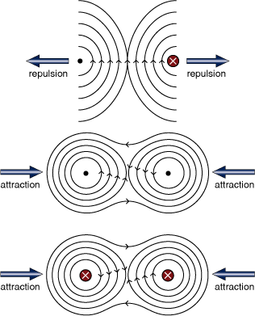

## Forces between Currents

  - Can be worked out by considering one wire’s magnetic field (using
    Right Hand Grip rule), drawing a tangent at the position of the the
    other wire and then applying Fleming’s Left Hand Rule
