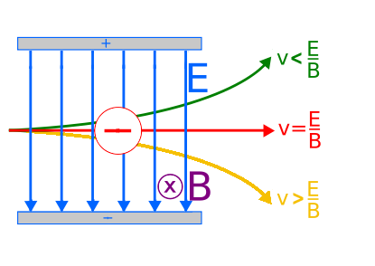

## Crossed-Fields (Velocity Selector)

A uniform magnetic field and a uniform electric field can select for velocity of charged particles as:

1. electric and magnetic fields are normal to each other

2. velocity of charged particle normal to both fields

3. forces on particle due to fields are in opposite directions

4. forces are equal for particles with a particular speed

- Considering a setup where electric and magnetic field are
  perpendicular to each other and act on a moving charge
  simultaneously

- In such case, a certain velocity exists where fields exert equal and
  opposite forces.

$$BQv = QE$$

$$v = \frac{E}{B}$$

- **If velocity higher,** $\mathbf{F = BQv}$ **hence magnetic force
  stronger & effect of force due to electric field decreases**

- **If velocity lower,** $\mathbf{F = BQv}$ **hence magnetic force
  weaker & effect of force due to electric field increases**