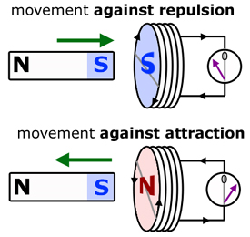

## Faraday’s and Lenz’s Law

- **Faraday’s Law:** the **magnitude** of induced e.m.f is proportional to the rate of change of magnetic flux-linkage

$$V = \frac{\text{dNϕ}}{\text{dt}}$$

- **Lenz’s Law:** the **direction** of the induced e.m.f. is such that it produce effects to oppose the flux change causing it

$$V = \frac{- dN\phi}{\text{dt}}$$

Hence Faraday’s Law to explain why:

1) there is a reading on the voltmeter

   Ans: Moving magnet causes a change of flux linkage

2) this reading varies in magnitude

   Ans: Speed of magnet varies so varying rate of change of flux

3) the reading has both positive and negative values

   Ans: Magnet changes direction of motion

**Fleming’s Right Hand Rule:**

Fleming's right-hand rule determines the direction of induced current in a conductor moving within a magnetic field

**Fleming’s Left Hand Rule:**

Fleming's left-hand rule determines the direction of force (motion) acting on a current-carrying conductor in a magnetic field

**Experiment that demonstrate Faraday’s and Lenz’s Law (Generator):**

* **Rotation & Flux Change:** As the coil is mechanically rotated inside the magnetic field, the angle $\theta$ between the field lines and the normal to the coil changes continuously.

* **Inducing e.m.f.:** The continuous change in magnetic flux linkage ($N\Phi = NBA \cos\theta$) induces an alternating electromotive force ($\text{e.m.f.}$) across the ends of the coil according to Faraday's Law.

* The e.m.f. of the induced current can be increased by increasing the number of coils, increasing the power of the magnets, increasing the area of the coils or increasing the angular speed of the rotational motion.

