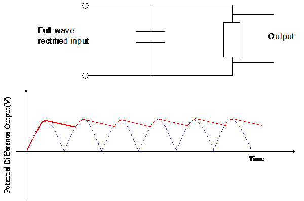

## Smoothing

  - In order to produce steady d.c. from ‘bumpy’ d.c. that results from
    rectification requires a smoothing capacitor

  - The capacitor charges and maintains the voltage as a.c. voltage
    rises, (first half of the wave).

  - As the wave slopes downward, the capacitor begins to discharge in
    order to maintain the voltage

  - A small capacitor discharges more rapidly than a large capacitor and
    gives rise to a greater ripple in output

  - If the load resistor is small, the capacitor will also discharge
    rapidly

  - $\text{CR}$ is the time constant of a capacitor resistor: time
    taken for charge to fall $\frac{1}{e}$ times original value
    - Time constant is the time taken by capacitor to discharge to 37% of its original $V/C/Q$

  - Value should be much greater than the time period of a.c. supply so
    capacitor does not have sufficient time to discharge significantly

  - In general, the greater the value $R\  \times \ C$, the smoother
    the rectified a.c.