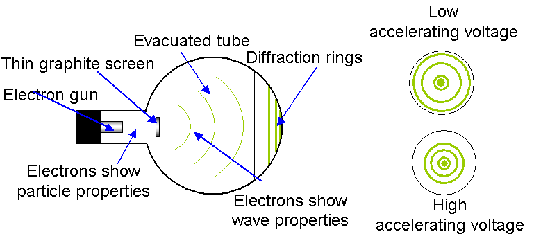

## Electron Diffraction

* de Broglie suggested since waves can behave like particles,
  particles should be able to behave like waves
* **Matter Wave:** a moving particle of matter of momentum $p$ will
  have an associated wave of wavelength $\lambda$ where

$$
\lambda = \frac{h}{p} = \frac{h}{\text{mv}}
$$

where $h$ is Plank’s constant, $m$ is the mass, and $v$ is the particle's velocity. $\lambda$ is the de Brogile wavelength

**Diffraction of Electrons:**

1. **The Experiment:**

   A beam of electrons is accelerated through a high potential difference V (gaining kinetic energy $$eV = \frac{1}{2}mv^2$$) and directed at a thin slice of polycrystalline graphite target.

2. **Observation:**

   The emerging electrons strike a fluorescent screen, producing a pattern of concentric bright and dark rings—a **diffraction pattern**.

3. **Why This Proves Wave Behavior:**

   * Diffraction and interference are uniquely **wave phenomena**; particles governed purely by classical Newtonian mechanics would simply scatter randomly or pass straight through to form a single spot.

   * The spacing between graphite carbon atoms (∼ 1−3 nm) acts as a diffraction grating because it matches the calculated de Broglie wavelength (λ=mvh​) of the accelerated electrons.

   * Increasing the accelerating voltage increases velocity $v$, which decreases the de Broglie wavelength ($λ \propto v$​). Visually, this causes the diffraction rings on the screen to **shrink tighter**, confirming de Broglie's relationship.

4. **Conclusion:**

   * Electrons are known to possess **mass and charge**, and can be deflected by electric/magnetic fields (behaving as **particles**).

   * However, when travelling through atomic structures, they undergo diffraction and produce interference fringes (behaving as **waves**).

   * This dual behavior shows that particles of matter exhibit **Wave-Particle Duality**, just like electromagnetic radiation.