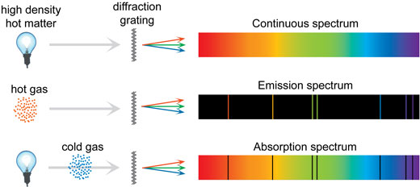

## Line Spectra

 

* **Emission Line Spectra:** the composition of light emitted by a hot gas
  * The frequencies emitted by atoms of a substance when they
    de-excite from higher to lower energy levels
* **Absorption Line Spectra:** when white light is passed through a cool gas
  * The frequencies absorbed from a continuous spectrum by the
    electrons a substance
* The emission and absorption spectra are characteristic of each
  element

