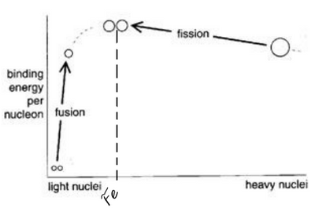

## Nuclear Fission & Fusion

- **Fission:** process in which a massive nucleus splits to form two
  smaller fragments

  - The large nucleus has a lower binding energy per nucleon so
    splits into **fission fragments** which have higher binding
    energy per nucleon $\therefore$ more stable

- **Fusion:** process by which two very light nuclei join together to
  form a heavier nucleus

  - Two light nuclei fuse so the final binding energy per nucleon
    will be greater than the original value

- In general, if energy is released in a nuclear reaction, then it
  shows that the binding energy of the product nuclei is greater than
  that of the reactants

**Question:**

Consider the fusion reaction:

$${}^{2}_{1}\text{H} + {}^{3}_{1}\text{H} \rightarrow {}^{4}_{2}\text{He} + {}^{1}_{0}\text{n}$$

Calculate:

1. The mass defect $\Delta m$ and binding energy $E_b$ of the resulting helium nucleus (${}^{4}_{2}\text{He}$, rest mass $= 4.0015\text{ u}$).

2. The total energy released ($\Delta E$) in the reaction.

*(Data: $m_p = 1.0073\text{ u}$, $m_n = 1.0087\text{ u}$, $m({}^{2}_{1}\text{H}) = 2.0141\text{ u}$, $m({}^{3}_{1}\text{H}) = 3.0160\text{ u}$, $1\text{ u} = 1.66 \times 10^{-27}\text{ kg} \approx 931.5\text{ MeV}$)*

**Solution:**

1. **Helium Nucleus Binding Energy:**

   $$\Delta m = [2(1.0073) + 2(1.0087)] - 4.0015 = \mathbf{0.0305\text{ u}}$$

   $$E_b = 0.0305 \times 931.5\text{ MeV} = \mathbf{28.4\text{ MeV}} \quad \left\(\text{per nucleon: } \frac{28.4}{4} = \mathbf{7.1\text{ MeV}}\right\)$$

2. **Energy Released in Reaction ($\Delta E = \Delta m \cdot c^2$):**

   $$\Delta m_{\text{reaction}} = (2.0141 + 3.0160) - (4.0015 + 1.0087) = 0.0199\text{ u}$$

   $$\Delta E = 0.0199 \times (1.66 \times 10^{-27}\text{ kg}) \times (3.00 \times 10^8\text{ m s}^{-1})^2 = \mathbf{2.97 \times 10^{-12}\text{ J}} \quad (\approx \mathbf{18.5\text{ MeV}})$$