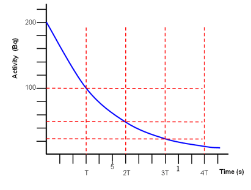

## Exponential Nature

### **Exponential Decay Laws ($x = x_0 e^{-\lambda t}$)**

* Because rate of decay is proportional to the number of undecayed nuclei, decay follows an exponential decrease:

  $$N = N_0 e^{-\lambda t}$$

  $$A = A_0 e^{-\lambda t}$$

  $$C = C_0 e^{-\lambda t}$$

  * $N_0, A_0, C_0$ = Initial number of nuclei, initial activity, and initial count rate at $t = 0$

  * $N, A, C$ = Number of nuclei, activity, and count rate at time $t$

  * $\lambda$ = Decay constant

  * $t$ = Time elapsed

* **Linear Form:**

  $$\ln(x) = \ln(x_0) - \lambda t$$

  *(Plotting $\ln(x)$ vs. $t$ gives a straight line with gradient $= -\lambda$ and y-intercept $= \ln(x_0)$)*

### **Half-Life ($t_{1/2}$)**

* **Definition:** The **time taken for the number of undecayed nuclei (or the activity) to reduce to half of its initial value**.

* **Successive Half-Lives:**

  * After $n$ half-lives:

    $$N = N_0 \left\(\frac{1}{2}\right\)^n \quad \text{or} \quad A = A_0 \left\(\frac{1}{2}\right\)^n$$

  * Where $n = \frac{t}{t_{1/2}}$

### **Relationship Between $t_{1/2}$ and $\lambda$**

* **Derivation:**

  * When $t = t_{1/2}$, $N = \frac{1}{2}N_0$:

    $$\frac{1}{2}N_0 = N_0 e^{-\lambda t_{1/2}}$$

    $$\ln\left\(\frac{1}{2}\right\) = -\lambda t_{1/2} \implies -\ln 2 = -\lambda t_{1/2}$$

* **Formula:**

  $$t_{1/2} = \frac{\ln 2}{\lambda} \approx \frac{0.693}{\lambda}$$