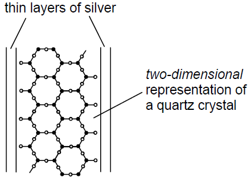
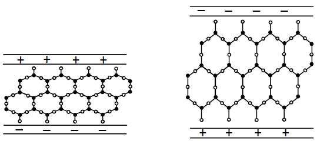

# Medical Imaging

## Ultrasound Waves

* Ultrasound is any sound wave that has a frequency above the upper
  limit of human hearing, 20 kHz
* Piezo-electric transducers can be used to record and produce
  ultrasound waves
* A diagram of a Piezo-electric transducer:

* Quartz crystal is the macromolecule formed by silicon dioxide

**Piezoelectric Transducer:**

* **Piezoelectric Effect:** The production of an e.m.f. across a crystal when deformed mechanically, or a change in shape when a potential difference (p.d.) is applied.

* **Generation of Ultrasound:**

  * An alternating high-frequency p.d. is applied across a quartz crystal.

  * The crystal vibrates at the same frequency as the applied p.d..

  * To produce maximum amplitude (resonance), the crystal thickness must be cut to equal half a wavelength ($\lambda/2$).

* **Detection of Ultrasound:**

  * Reflected sound pulses hit the crystal, causing mechanical vibrations.

  * This induces an alternating voltage across the crystal, which is converted into an electrical signal for image processing.

**Diagnostic Imaging**: Ultrasound pulses are transmitted into the body. Reflections occur at boundaries between different tissue types due to differences in acoustic impedance. The time delay between sending and receiving the reflected echo gives the depth of the boundary, while the echo intensity provides information on the nature of the boundary.