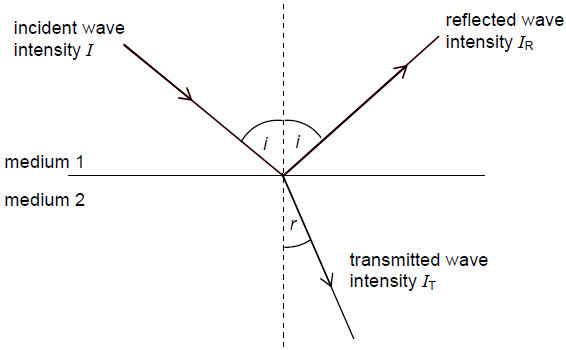

## Reflection of Ultrasonic Waves

- Ultrasound requires ultrasonic waves to pass from one medium to
  another

- When a beam of ultrasound wave reaches a boundary between two
  different media, the beam is partially refracted and partially
  reflected

**Ultrasound Medical Imaging:**

* Short pulses of ultrasound are emitted to prevent overlapping of transmitted and reflected waves.

* Echoes return from boundaries between different tissues (e.g., muscle/fat, tissue/bone).

* **Information Extracted:**

  * **Time delay** between pulse emission and detection determines the **depth** of the boundary.

  * **Reflected intensity** provides details about the **nature** of the boundary.

* **Resolution:** Higher frequencies yield shorter wavelengths, improving spatial resolution for finer details.

**Acoustic Impedance & Intensity Reflection:**

* **Specific Acoustic Impedance ($Z$):** Resistance encountered by ultrasound passing through tissue, given by:

  $$Z = \rho c$$

  *(where $\rho$ is density, $c$ is speed of sound in medium)*.

* **Intensity Reflection Coefficient ($\alpha$):** Fraction of intensity reflected at a boundary:

  $$\alpha = \frac{I_R}{I_0} = \frac{(Z_2 - Z_1)^2}{(Z_2 + Z_1)^2}$$

* **Coupling Gel:** Air and skin have vastly different $Z$ values, causing almost total reflection. Gel with $Z \approx Z_{\text{skin}}$ is placed on skin to eliminate air gaps and ensure transmission into the body.

**Attenuation of Ultrasound:**

* Reduction in beam intensity due to absorption and scattering in matter.

* Follows exponential decay:

  $$I = I_0 e^{-\mu x}$$

  *(where $\mu$ is the linear attenuation coefficient, $x$ is thickness)*.

  **Diagnostic Ultrasound Imaging:**

* **Pulses:** Short **pulses** of ultrasound are emitted by the transducer into the body to prevent overlapping of transmitted and reflected signals.

* **Reflection at Boundaries:** Reflections occur at **boundaries** between different tissues due to a difference in **specific acoustic impedance ($Z$)**.

* **Time Delay ($\Delta t$):** The **time delay** between emitting the pulse and receiving the echo determines the **depth** of the boundary.

* **Intensity ($I$):** The **intensity of the reflected echo** indicates the **nature/type of tissue boundary**.

* **Coupling Gel:** Gel with acoustic impedance $Z \approx Z_{\text{skin}}$ is applied between transducer and skin to **eliminate air gaps**, avoiding almost total reflection.