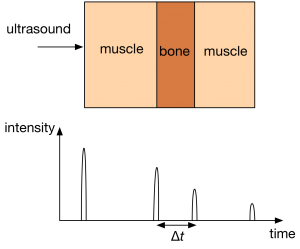

## Ultrasound Imaging Procedure

- Transducer is placed in contact with skin and a gel acting as a
  coupling medium

- Pulses of ultrasound are directed into the body

- The wave is reflected at boundary between tissues

- The reflected pulse is detected and processed

- The time for return of echo gives information on depth

- Amount of reflection gives information on structures

- Two techniques for display:

  - **A-scan**: measures distance of different boundaries from
    transducer held in one position graphically

  - **B-scan**: repeats A-scan from multiple angles to form 2
    dimensional image

**Piezoelectric Transducer (Generation vs. Detection Table):**

#|
||

**Function**

|

**Applied Input**

|

**Mechanism**

|

**Output Signal**

||
||

Generation

|

Alternating high frequency p.d.

|

Crystal vibrates at the same frequency as the applied p.d.

|

High frequency ultrasound waves transmitted into body tissue

||
||

Detection

|

Incident ultrasound echos

|

Returning puleses hit the crystal, causing mechanical vibrations

|

Induces an alternating voltage across crystal faces for processing

||
|#

