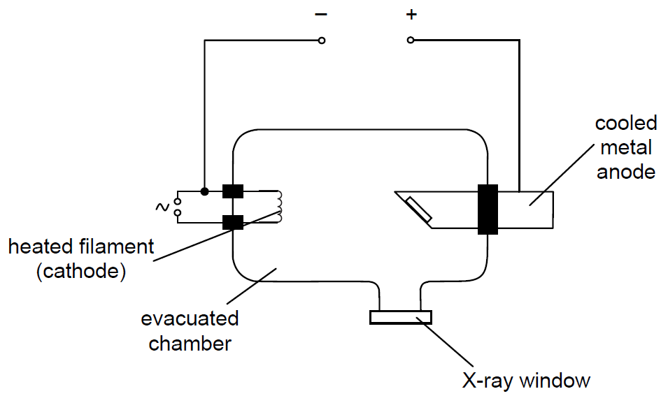

## X-Ray Production

* X-rays are a form of electromagnetic radiation
* Produced when high-speed electrons hit metal targets

* **Thermionic Emission:** Heated cathode filament releases electrons.

* **Acceleration:** High potential difference ($V \sim 20\text{--}100\text{ kV}$) accelerates electrons toward a tungsten anode target.

* **Kinetic Energy Conversion:**

  * \<1% of electron kinetic energy converts into X-ray photons; \>99% transfers to thermal energy at the anode.

  * Anode rotates (or water-cooled) to prevent overheating.

* **Minimum Wavelength / Maximum Frequency:**

  $$E_{\text{max}} = eV = hf_{\text{max}} = \frac{hc}{\lambda_{\text{min}}} \implies \lambda_{\text{min}} = \frac{hc}{eV}$$

* Some ‘soft’ X-rays are always produced which cannot fully pass
  through the patient and contribute to the total radiation dose of
  the patient.

* To reduce the radiation dose hence cut off ‘soft’ X-rays, an
  aluminium filter used to absorb them