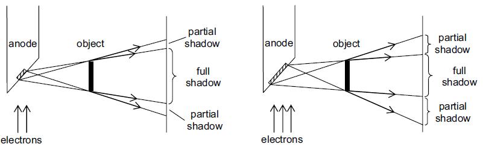

## X-Ray Quality

- **Sharpness** is the ease with which the edge of a structure can be
  determined

  - Improving sharpness of X-Ray:

    - Reduce aperture size (window): reduces beam width

    - Place lead grid in front of photographic film: absorbs scattered
      X-rays and reduces partial image

    - Reduce the area of target anode

- **Contrast** is the visual difference between the areas of
  blackening and light

  - Improving contrast of X-Ray:

    - Increase Exposure time

    - Use harder X-Rays: increases penetration power

    - Reduce scattering of X-Ray beam

    - Use fluorescent ‘contrast medium’