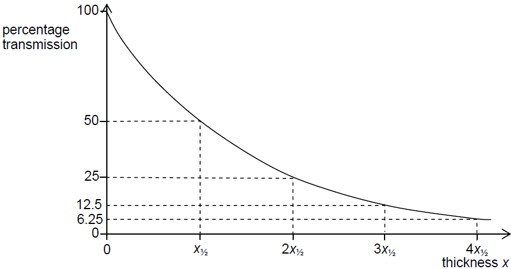

## X-Ray Intensity

- In medium where X-Rays **are** absorbed, intensity of a parallel
  X-Ray beam decreases by a constant fraction in passing through equal
  small thicknesses of the medium.

- This gives rise to an exponential decrease in the intensity of the
  transmitted beam:

$$I = I_{0}e^{- \mu x}$$

- $I$ is the instantaneous intensity of the X-ray beam

- $I_{0}$ is the initial intensity of the X-Ray beam

- $x$ is the thickness of the medium passed by X-Ray

- $\mu$ is the **linear absorption coefficient** unique to medium,
  dependent on photon energy and in ${\text{mm}^{-1}} $

- This can be represented graphically:

- **Half-value Thickness (**$\mathbf{x}_{\mathbf{1/2}}$**):**
  thickness of the medium required to reduce the transmitted intensity
  to one half of its initial value

- Related to the linear absorption coefficient by:

$$x_{1/2} \times \mu = \ln 2$$

**Question:**

1. Edward teared his meniscus in his knee when he was jumping around and needs a scan. An X-ray beam of initial intensity $I_0$ passes through a muscle tissue layer of thickness $15\text{mm}$. The linear attenuation coefficient of muscle tissue is $\mu = 0.23\text{ mm}^{-1}$. Calculate the fraction of intensity transmitted ($\frac{I}{I_0}$).

2. An ultrasound beam travels from fat ($Z_1 = 1.38 \times 10^6\text{ kg m}^{-2}\text{ s}^{-1}$) to muscle ($Z_2 = 1.70 \times 10^6\text{ kg m}^{-2}\text{ s}^{-1}$). Calculate the intensity reflection coefficient $\alpha$. Explain what this value signifies.

**Solution:**

1. **X-Ray Attenuation:**

   $$I = I_0 e^{-\mu x} \implies \frac{I}{I_0} = e^{-(0.23\text{ mm}^{-1})(15\text{ mm})} = e^{-3.45} \approx 0.0317$$

2. **Ultrasound Intensity Reflection Coefficient ($\alpha$):**

   $$\alpha = \frac{I_R}{I_0} = \frac{(Z_2 - Z_1)^2}{(Z_2 + Z_1)^2} = \frac{(1.70 \times 10^6 - 1.38 \times 10^6)^2}{(1.70 \times 10^6 + 1.38 \times 10^6)^2} = \frac{(0.32 \times 10^6)^2}{(3.08 \times 10^6)^2} \approx 0.0108$$

   * **Significance:** $\alpha \approx 0.011$ means that approximately $1.1$% of the incident ultrasound intensity is reflected back at the boundary, while the remaining **$98.9$%** is transmitted deeper into the tissue layer. This low reflection percentage allows ultrasound to penetrate through multiple tissue layers while still providing enough echo to detect tissue boundaries.