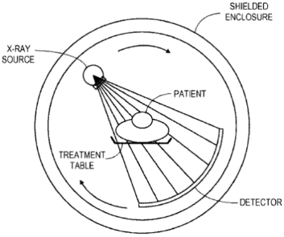

## Computed Tomography (CAT/CT Scan)

- X-Ray imaging only produces a 2 dimensional image with no impression
  of depth, cannot tell if tissue is near to the surface or deep
  within the body

- Tomography is a procedure which forms a 3 dimensional plane of the
  object

- The diagram below shows the procedure

- Putting together several planes produces a whole 3 dimensional image
  which can be rotated
- **Advantages of a CT scan:**
  - Produce images that show three-dimensional relationships between different tissues

  - Can distinguish tissues with quite similar densities