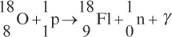

## Positron Emission Tomography (PET)

* Uses: diagnosing cancers, heart diseases, gastrointestinal disorders and brain function

### Radiotracer

* Radiotracer: made by fluorodeoxyglucose, glucose base molecule with attachment of fluorine-18. Radiotracer will emit beta\+ particle (positron).

  Radiotracer is injected into vein, travels through the body and is absorbed by organs.

* Cancer cells are more active, so they absorb glucose and decay more rapidly.

### Annihilation

1. Isotope fluorodeoxyglucose decays by emitting beta\+ (positron, antiparticle of electron)
2. Positron moves a short distance and pair with an electron
3. The pair will annihilate and their mass becomes pure energy
4. Two gamma rays emitted in opposite direction
5. Gamma rays will be detected

*Noted that in this process, both the energy and momentum are conserved.*

### Determining Positron Emission Location via Arrival Times

* **Line of Response (LOR):** Two gamma-ray ($\gamma$) photons emitted during annihilation travel in straight lines in opposite directions and hit opposing detectors in a ring surrounding the patient.

* **Arrival Time Difference ($\Delta t$):** If the annihilation event occurs exactly at the midpoint between two detectors, both photons arrive simultaneously ($\Delta t = 0$).

* **Position Calculation:** If the annihilation occurs closer to one detector, its photon arrives first. The computer uses the precise time difference $\Delta t$ between the two detector arrivals to calculate the exact displacement $x$ from the midpoint along the LOR:

  $$\Delta x = \frac{c \cdot \Delta t}{2}$$

  *(where $c$ is the speed of light)*

* **3D Image Reconstruction:** Processing millions of these lines of response at varying angles constructs a high-resolution 3D map of tracer concentration.

**Question:**

A positron ($\beta^+$) emitted by Fluorine-18 collides with an electron ($e^-$) at rest and annihilates, producing two identical gamma-ray ($\gamma$) photons.

*(Data: Mass of electron/positron $m_e = 9.11 \times 10^{-31}\text{ kg}$, Speed of light $c = 3.00 \times 10^8\text{ m s}^{-1}$, Planck's constant $h = 6.63 \times 10^{-34}\text{ J s}$)*

1. Calculate the energy released (in Joules) by one gamma-ray photon.

2. Calculate the frequency of the emitted gamma-ray.

**Solution:**

1. **Energy of One Photon:**

   By mass-energy equivalence $E_{\text{total}} = 2 m_e c^2$. Since two identical photons are produced, the energy of **a single photon** $E_\gamma$ equals the rest mass energy of one particle:

   $$E_\gamma = m_e c^2 = (9.11 \times 10^{-31}\text{ kg}) \times (3.00 \times 10^8\text{ m s}^{-1})^2 = 8.20 \times 10^{-14}\text{ J}$$

   *(or $\approx 0.511\text{ MeV}$)*

2. **Frequency:**

   $$f = \frac{E_\gamma}{h} = \frac{8.20 \times 10^{-14}\text{ J}}{6.63 \times 10^{-34}\text{ J s}} = 1.24 \times 10^{20}\text{ Hz}$$