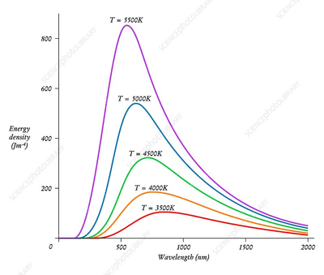

## Wien’s Displacement Law

* **Definition:** The wavelength corresponding to peak emission intensity ($\lambda_{\text{max}}$) is inversely proportional to the thermodynamic temperature ($T$) of a black-body.

  $$\lambda_{\text{max}} \propto \frac{1}{T}$$

* **Equation:**

  $$\lambda_{\text{max}} T = b$$

  * $\lambda_{\text{max}} = \text{Peak emission wavelength } (\text{m})$

  * $T = \text{Surface temperature of the star } (\text{K})$

  * $b = \text{Wien's displacement constant } (2.9 \times 10^{-3} \text{ m K})$

* **Key Concept:** Hotter stars emit radiation with shorter peak wavelengths (appearing blue/white), while cooler stars emit longer peak wavelengths (appearing red/yellow).

**The Graph:**     

*(No need to memorize the values, but the features of the graph need to be memorized)*

### Light Year

Distance travelled by light in a vacuum in a year