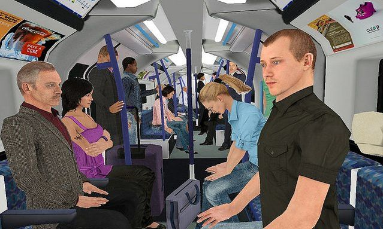

## Types and Characteristics

**Types**

* **Simple:** gradual withdrawal from reality
* **Paranoid:** having delusional thoughts and hallucinations
* **Catatonic:** no response to the environment; would remain
  rigid/unmoving or would engage in constant repetitive movements.
* **Disorganised:** thoughts and speech are jumbled and impossible to
  understand (word salad).
* **Undifferentiated:** has symptoms but doesn’t fit into the above categories

**The DSM-5 outlines the following psychotic symptoms:**

* **Positive symptoms:** additional symptoms to normal behaviour, e.g:
  * **Delusions:** non-realistic beliefs, e.g. believing someone will harm/kill you.
  * **Hallucinations:** false sensory experiences e.g. hearing voices.
  * Disorganised thoughts and catatonic behaviour
* **Negative Symptoms:** symptoms that lack normal behaviour, e.g. loss of speech, withdrawal from society, or loss of typical facial expressions (flat affect).

### **Delusional Disorder**

* When a person experiences persistent delusion (for a month or
  longer) but otherwise has normal behaviour.
* It excludes positive or negative psychotic symptoms.
* **Types of delusional disorder:**
  * **Erotomanic**: belief someone is in love with you.
  * **Grandiose**: the belief that they have great unrecognised skill or status.
  * **Jealous**: belief that partner is unfaithful (paranoia).
  * **Persecutory**: the belief that people conspire against or want to harm you (paranoia).
* **Bizarre Delusion:** logically impossible.
* **Non-Bizarre:** possible but unlikely.

### **Symptom Assessment Using Virtual Reality (Freeman, 2008)**

* **Freeman** explores the potential for VR to eliminate challenges such as misinterpretations of social interaction (leading to paranoia, withdrawal, etc) when checking symptoms and developing treatment for schizophrenia.
* **Typically**, symptom assessment involves the interviewer and patient sitting in a clinical room, discussing behaviour over the past week/month – however, this heavily relies on the patient answering truthfully.
* **Using VR:**
  * The assessment can be novel and standardised
  * Patients are presented with an artificial and neutral social situation with unresponsive avatars so that any paranoid thought is unfounded (having no basis) and genuine. This allows us to assess the severity of paranoid delusions.
  * The situation can easily be manipulated, and the patient’s behaviour monitored
  * **It can be used to develop a treatment as:**
    * Factors that worsen/improve the patient’s condition can be
      identified
    * Patients can be exposed to persecutory fears in the
      environment via VR so that they can learn to cope with it
      (or with the symptoms) in reality
* **Procedure in Freeman’s Study:** the user takes a walk or a ride in a specifically designed library or underground train scene amongst neutral avatars whilst wearing VR headgear.
* **Sample:** trialled in library scene of Freeman’s study is 12 males and 12 females from university college London with an average age of 26 years

\

* **Before the test:** multiple validated measurement tools (such as the 16-item Green Et al. Paranoid Thoughts Scale (GPTS) Part B) were used to assess the user’s paranoid thinking, emotional distress and other social and cognitive traits.
* **After the test:** persecutory thinking, visual analogue rating scale (used to measure frequency of symptoms) and degree of immersion in a virtual environment were taken.
* **Result:**
  * High scores on the paranoia assessment questionnaire had high levels of persecutory ideation.
  * Individuals who experience auditory hallucinations in the real world experience them in VR, too.

**Evaluation:**

* Large sample but no clinical population.
* VR used a standardised approach to assessing symptoms, hence
  increasing reliability of measurement.
* Low ecological validity as the environment is simulated.
* The use of self-reports may lead to response bias.

**Issues and debates:**

* **Relevance to everyday life:** identify symptoms, causal factors
  and treatment strategies.
  * It is not used extensively in clinical populations, so it is yet to be determined whether it can replace clinical interviews and questionnaires in diagnosis.
* **Cultural Bias:** relies on culturally based expectations of what determines normal social behaviour. Different cultures have different interpretations of normal behaviour, so these factors must be considered when diagnosing symptoms and behaviour to avoid biased results.