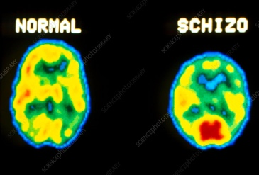

## Explanations

### **Genetic (Gottesman & Shields, 1972)**

* They believe that there is a genetic relationship with a person with schizophrenia, which can be inherited.
* They believed that a series of genetic abnormalities caused symptoms like psychosis, and these have genetic origins called endophenotypes (genetic markers with known locations used to identify individuals) that could be inherited.
* To test this, they carried out a longitudinal twin study in
  monozygotic (identical twins sharing all their DNA) and dizygotic
  (fraternal sharing 50% of DNA) twins to test genetic concordance of
  schizophrenia.
* **Sample:** 57 pairs of twins (24 MZ, 33 DZ) were drawn from 467
  twins registered at Maudsley Hospital (London).
  * Twins were identified as MZ/DZ through blood group and
    fingerprint analysis.
  * Parents and twins were interviewed, some of whom were diagnosed
    with schizophrenia.
* Participants took cognitive tests like object sorting (?)
* External judges independently evaluated case summaries of each participant to find co-twin schizophrenic concordance.
* **Results:**
  * MZ twins share 50% schizophrenic concordance; DZ have only 9%
    concordance.
    * **Concordance:** the presence of observable trait/disorder in both co-twins.
  * In MZ twins, twin 1 was more likely to be schizophrenic if the
    illness of twin 2 was severe.
  * In mild illness, co-twin concordance is far lower.

**Evaluation:**

* Large sample; generalisable to twins but not to non-twins.
* Assessment made by independent judges, reducing researcher bias.
* Qualitative data collected, such as interviews (in-depth), although it is more subjective.

### **Biochemical (Dopamine Hypothesis) (Lindstrom et al., 1999)**

* The hypothesis states that the brains of schizophrenic patients produce/transmit excess dopamine, have increased amounts of dopamine receptors, or have receptors with increased sensitivity to dopamine, which disrupt the normal transmission of nerve impulses and are linked to positive symptoms.
* It is thought that excess dopamine in specific brain areas, e.g. Broca’s region (responsible for the formation of language), can lead to certain symptoms, e.g. impaired logical speech.
* Drugs that increase dopamine levels (amphetamine and cocaine) are
  correlated with hallucinations and delusions.
* **Parkinson’s disease** is treated with a synthetic form of dopamine called ‘L-dopa’. If the dosage is too high, it creates symptoms identical to schizophrenia, e.g. hallucinations.
* Post-mortem studies, brain scans and autopsies have shown that schizophrenic patients have a larger number of dopamine receptors than usual.
  * **Wise et al. (1974)** found low enzyme levels that break down dopamine in brain fluid, thus increasing its quantity.
* **Positron Emission Tomography (PET):** gamma cameras to detect radioactive tracers, e.g. glucose in blood. Tracer accumulates in areas of high activity, showing visibility during analysis.
  * High dopamine receptors in the striatum, limbic system and cortex indicate high dopamine activity contributing to positive symptoms; low levels in the prefrontal cortex indicate negative symptoms (flat affect).

 

### **Cognitive (Frith, 1992)**

* **Frith** emphasises the importance of faulty mental processing rather
  than relying solely on physiological explanations.
* He describes schizophrenia as an abnormality of self-monitoring.
* He wanted to test the idea that schizophrenic patients confused inner talk with hallucinations.
* Thus, he asked patients to decide whether items read aloud were done by an experimenter or computer.
* Patients with incoherent speech performed worst, which may be linked
  to memory and attention difficulties, crucial to self-monitoring.
* Delusional thinking may be an outcome of misinterpretation of
  perception
  * E.g. traffic lights turning red may be interpreted as the Martians are about to land.
* **Applying logical reasoning to hallucinations results in delusions.**
  * If you have an auditory hallucination where you constantly hear ‘die’ – adding logical reasoning to it: ‘I stole his girlfriend, so he’s out to kill me’ leads to paranoia and persecutory ideation.
* **Failure in monitoring results in auditory hallucinations, alien
  control and thought insertion.**
  * **Alien Control:** misattributes self-generated actions to an external source.
  * **Thought Insertion:** feeling as if one's self-generated thoughts are not one's own but rather have come from an external source and have been inserted into one's mind.
  * **Auditory Hallucination:** inner speech is not recognised as self-generated but instead attributed to an external source.
* The inability to monitor the intentions of others, perhaps due to impaired theory of mind, can lead to paranoia and incoherence.
* Frith says that negative symptoms are a result of the individual's impairment to produce spontaneous actions and that external stimuli are required for a response to be produced
* Flat affect, social withdrawal and lack of speech result from
  difficulty in monitoring mental state.

**Issues and Debates:**

* **Nature vs Nurture:**
  * A longitudinal twin study found a causal link between genes (nature) and mental disorders.
  * However, MZ twins are treated more similarly than DZ twins as they are always the same gender and look more alike, unlike DZ twins, who are treated like ordinary non-twin siblings. Thus, differences between MZ and DZ could also be due to nurture.
* Biological and biochemical explanations are considered **reductionists,** as they attribute the cause of schizophrenia to a specific biological origin.
  * For biological explanation, it is genes or gene combinations.
  * For biochemical explanation, it disrupts the normal uptake of a specific neurotransmitter – dopamine.
  * However, they consider environmental factors important to the onset of the disorder.
* Cognitive by **Frith** is more **holistic** as it considers both mental processing and biological causes but could still be said to ignore environmental and social causes.
* Unlike psychologists from social or psychodynamic traditions, these all point towards individual explanations. They would look towards situational factors such as traumatic events or difficulty forming early relationships.

