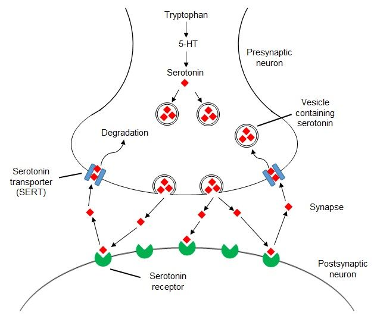
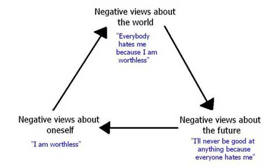
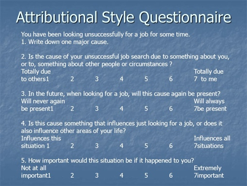

## Explanations of Depression

### **Biological: Genetic and Neurochemical (Oruc et al. 1997)**

* **Genetic:** Some illnesses have a genetic basis and can be transmitted from generation to generation. First-degree relatives (parents and siblings) share 50% of their DNA.
  * MZ and DZ twins can be used to investigate whether there is a genetic link in depression.
* **Neurochemical:** An imbalance of chemicals affects the brain's functioning and, consequently, the mood. Depressed individuals have low activity of serotonin and norepinephrine neurotransmitters.
* **Sample:** 42 participants (25F, 17M) diagnosed with bipolar disorder, aged between 31-70, were drawn from two psychiatric hospitals in Croatia.
  * A healthy control group of 40 participants with no personal/family history of mental disorders were also included (they were also matched for sex and age).
* Sixteen of the bipolar participants had a first-degree relative with major disorders.
  * Participants and their families gathered this information and medical records.
* **Procedure:** DNA testing was carried out to test for **polymorphisms** (gene variation) in serotonin receptor 2c (5-HTR2C) and serotonin transporter (SERT/5-HTT) genes.

* **Results**:
  * There were no significant differences between the two groups.
  * However, serotonin (5-HT) is sexually dimorphic, and females had trends of polymorphism in the serotonin genes, which could be responsible for the increased risk of bipolar in females.
    * **Sexually dimorphic:** Any differences in males and females of a species, excluding organs and genitalia.

### **Cognitive (Beck, 1979)**

* Beck was interested in investigating the irrational thought processes in depression.
* The reason for an individual’s low mood is due to **incorrect information processing.**
* The negative views of a depressed person form a reality for them.
* This form of irrational thinking is called **cognitive distortion**, which is an automatic process that develops as a result of earlier life experiences through **schemas** (knowledge/memory)
  * Negative events and schemas activate the underlying negative assumptions and create pessimistic thoughts and beliefs about the future.

**Cognitive triad:**

* This leads to impairment in perception, memory, and problem-solving- the person is constantly overwhelmed with negative thoughts.

### **Learned Helplessness and Attributional Style (Seligman et al. 1988)**

* A behaviour that occurs as a result of a person having to endure an unpleasant situation which they perceive as inescapable.
* Seligman et al.’s view is that depression is a direct result of a real/perceived lack of control over the outcome of one’s situation – one feels helpless.
* The individual learns that they cannot control the situation and cannot prevent suffering, and eventually ceases to resist it.
* **For example,** in Seligman’s 1974 research on dogs, they received electric shocks preventing them from escaping (experiencing a lack of control). They accepted the situation and eventually stopped trying to escape. In future trials, they had an opportunity to escape, but due to experience, they did not try.
* **Attribution:** The cognitive process wherein individuals explain the causes of events and behaviour. It may be faulty/biased based on previous life experiences.
* A person who has had a difficult upbringing/experienced parental loss, e.g., will have learned helplessness and ∴ be inclined towards a **negative attributional style.**
* **A negative event can be attributed to:**
  * Internal (personal)/ external (environment)
  * Stable (constant)/unstable (occasional)
  * Global (affecting many aspects)/ specific (affecting one aspect)
* **Investigation:** how well attributional style could predict depressive symptoms.
* **Sample:**
  * 39 patients with unipolar depression
  * 12 with bipolar disorder during a depressive episode from the same clinic.
  * Included a mix of genders with a mean age of 36.
  * They were compared with a control group of 10 participants.
* **Procedure:**
  * All participants completed BDI to assess the severity of symptoms
  * Then, completed an Attributional Style Questionnaire (ASQ) consisting of 12 hypothetical good and bad situations.
  * They had to make causal attributions for each event and rate the cause on a 7-point scale for internality, stability, and globality.

**Note:** question 2 is about internal/external, Q3 is about stable/unstable, and Q4 is about global/specific.

* **Results:**
  * Bipolar and unipolar patients had more pessimistic, negative
    attributional styles than the control group.
  * The more severe the score on BDI, the worse the pessimism on
    ASQ.
  * For those with unipolar depression undergoing cognitive therapy,
    an improvement in attributional style correlated with an
    improvement in BDI score.
  * Thus, the way we make attributions is an important underlying
    mechanism of depression.

**Evaluation**

* **BDI and ASQ:**
  * Standardised measures used e.g. using the BDI and ASQ, which are both **valid**.
  * A positive correlation between BDI and ASQ does not indicate a causal relationship.
* **Oruc et al. (biological explanation):**
  * Limited sample size so difficult to generalise; genetic studies
    require a large sample to be valid and accurate.
    * Establishing the importance of serotonin-linked genes in
      increasing risk of depressive illness in females requires a
      large sample.
  * DNA samples were collected and analysed in a lab with automatic
    equipment, increasing **validity** and removing researcher bias.
* **Nature vs nurture:**
  * A biological explanation for depression reflects nature, e.g. Oruc et al.
  * Other explanations for depression e.g. adverse life events, are more nurture based e.g. learned helplessness.
* **Individual vs situational:**
  * **Individual:** Cognitive explanation assumes that depression arises due to the dysfunctional thinking of the individual rather than as a result of situational variables, e.g., a difficult childhood.
  * **Situational:** Learned helplessness arises due to the individual’s interaction with their environment.
* **Reductionist:** Genetic explanation is reductionist as it only considers a narrow set of genes (e.g. those relating to serotonin). It doesn’t fill all instances of depression or why not all first-degree relatives develop the same disorder.
* **Deterministic:** As we can’t change our DNA, and individuals who have a family history of depression are automatically at more risk, it makes the genetic cause of depression deterministic. However, as there is only a small genetic variation in females, there could be other non-genetic causes (non-deterministic).
* **BDI:** Application to real life as useful for clinicians, but subject to bias and social desirability.